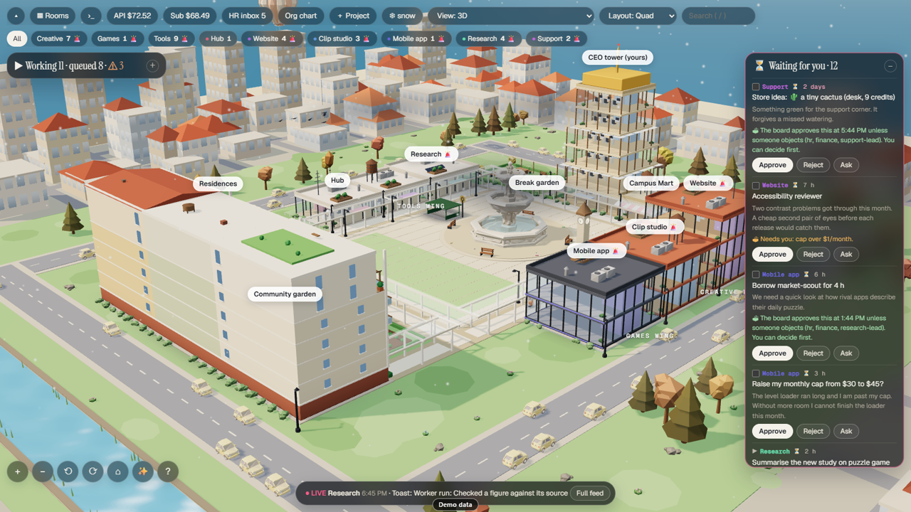
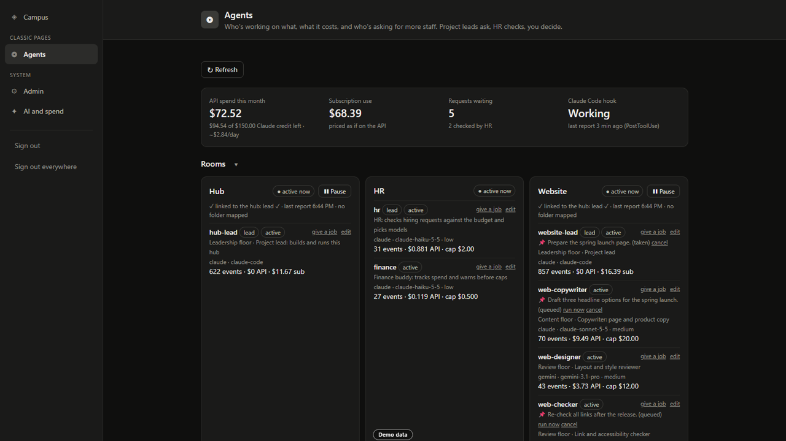

# Deskcity

Deskcity is one place on your own computer to see every AI worker you use, who is doing which job, what each costs against a monthly cap, and how good the work was.

Licence: MIT. It is free, and you pay your own AI providers.





*Both pictures are the sample hub from `npm run demo` (made-up data).*

## What it does

- **Shows all your AI workers in one place.** Claude, Gemini, OpenAI-style and local models, and coding agents such as Claude Code.
- **Shows who does which job**, and how work is handed from one worker to the next.
- **Tracks what each worker costs** against a monthly cap. A worker the hub runs cannot start a new job once it has used its cap; its jobs run one at a time, so jobs started together cannot all slip under it. The hub runs only models it has a price for.
- **Scores every finished job from 0 to 100.** The score is a guide you can overrule with a thumbs up or down.
- **Keeps you in charge.** Hires, questions from workers and money warnings land in one list called Waiting for you. Once you set a dashboard password, spending needs it. With no password, anything on this PC can start paid work; caps and hourly limits still apply.

## Everything it can do

The short list above is the core. The full list, each with its section in `docs/kit/USER-GUIDE.md`:

**Work across models**

- **Chain a job across models.** When you give a job, pick up to three more workers to take it next, each on its own model. When one step ends, the next worker gets the task and the last result. Steps for workers the hub runs start by themselves. (Section 6.)
- **Two kinds of worker.** Hub-run workers: the hub calls the model itself (Claude, Gemini, OpenAI-style APIs, or a local model server). Reporting workers: tools that run outside the hub, such as Claude Code and other coding agents, chat apps and scripts, report what they did. (Section 5.)
- **One command connects Claude Code.** A hook makes every Claude Code session in a project folder report in. Other tools report through one small script. (`docs/kit/REPORTING.md`.)
- **A declined job can go to the next provider.** When a provider's filter refuses a harmless job, the hub notes who declined and why, and passes it once to the next provider you have a key for. Serious reasons always stop and come to you. (Section 6.)
- **Workers can hand work on by themselves**, with a limit on how long a chain gets and how many paid jobs start per day without you. (Section 6.)

**See what happened**

- **An AI call log.** Every call's worker, model, tokens, cost and time.
- **Replay a finished job** step by step in the Neural view.
- **A live feed** of who took what, who handed it on, and what came back.
- **A quality score** on every finished job, and a count of refusals per provider and worker. (Section 8.)

**Stay in charge of money and staff**

- **Monthly caps per worker**, hourly limits on spending actions, and a password on anything that spends. (Section 7.)
- **AI helpers are off until you switch them on**, with their own daily limit. (Section 7.)
- **HR.** A project lead asks for staff; HR checks the request against your budget and models; you approve the hire. (Section 5.)
- **Waiting for you.** One list for hires, questions, finished jobs and money warnings. (Section 6.)

**Run it your way**

- **Four views** of the same data (below), and a **command bar** for jobs and actions from the keyboard. (Sections 3 and 10.)
- **Phone alerts and phone access**, both off until you set them up. (Section 9.)
- **Nightly backups** with a restore test, and **updates that keep your data**: `npm run update`. (Sections 12 and 13.)
- **A sample hub with made-up data**: `npm run demo`, no keys needed.

**Optional parts** (each is a switch; section 4)

- **Campus life:** workers earn credits, shop at the campus store, keep a home and chat. For fun; it changes no work.
- **Board and finance buddy:** a stand-up of project leads and a plain-words note on where the money went.
- **Pull-request reviews**, and a team template for game development.
- **Add-ons, off by default and experimental:** a YouTube and TikTok video pipeline, trading card tools, a games tracker, a reading and watching list, and a to-do list.

## Four views of the same data

Pick how it looks and how heavy it is. Change your mind any time.

| View | What it is |
|---|---|
| 2D city | A flat map of your projects as buildings, with workers walking between them. The lightest campus. |
| 3D city | The same city in 3D. Needs a computer or phone that can run 3D. |
| Neural | The web of your workers and how they hand work to each other. Open any worker to see its jobs. |
| Pages | No city: plain web pages (Home, Agents and the rest). |

You choose the view at install. Each device can switch later, from the View picker on the campus or from the command bar. The 2D city and the Pages view never load the 3D code. The Light preset installs the 2D campus only.

## Try it without keys

Just want to look around? After `npm install`, run `npm run demo` and open <http://localhost:3960>. It is a sample hub with made-up data: no keys, no password, no AI calls, nothing sent out. A small "Demo data" label stays on screen. Details are in the user guide.

## Quick start (about 5 minutes)

You need [Node.js](https://nodejs.org) 20 or newer. Windows is the main tested system (see the FAQ for Mac and Linux).

**Windows: double-click `install.cmd`. Mac or Linux: run `bash install.sh`.**

It checks Node.js, installs the packages, makes your `.env` file, offers to set a password and a first setup, and checks the result. Each step says what it is doing, and you can run it again safely: it skips what is done. It needs no admin rights and sends nothing anywhere (npm fetches the packages, that is all). Optional extras, each off unless you say yes: a desktop icon and start at sign-in on Windows, and start at sign-in on Linux.

**Start it any time with `start.cmd` (or `bash start.sh`).** It opens your browser when the hub is ready and starts the hub again 10 seconds after a crash. To keep it from opening the browser, set `DESKCITY_NO_BROWSER=1`.

To remove the shortcuts later, double-click `uninstall-autostart.cmd` (Linux: `bash install.sh --remove-autostart`). Start at sign-in on a Mac is not covered.

### Or step by step

1. Get the files and open a terminal in the folder.

2. Install:

```
npm install
```

3. Copy `.env.example` to `.env`, open it, and paste your Claude key. More keys can wait. Never paste keys into a chat.

4. Set a dashboard password. You type it; it is stored only as a hash:

```
npm run set-password
```

5. Set up the hub. There are two ways.

   **With Claude Code:** open the folder in Claude Code and say "set up my hub". It follows `docs/kit/SETUP.md` and asks you a few questions.

   **Without Claude Code:** make a starting answers file (this creates the `data` folder if it is not there yet):

```
node tools/setup.mjs --example
```

   Edit `data/setup-answers.json` for your projects, then run:

```
node tools/setup.mjs --answers data/setup-answers.json
```

   Check what is in place at any time:

```
node tools/setup.mjs --check
```

6. Start the hub, then open <http://localhost:3000> (or use `start.cmd`, which also starts it again after a crash):

```
npm start
```

The hub answers this PC only until you turn on phone access (see the user guide).

## Privacy

A new hub, left idle, sends nothing anywhere. There is no telemetry, no automatic update check and no usage data (you can press a button to ask for the newest version; section 13 of the user guide). What can leave your computer, and only because you set it up:

- Your prompts and job text, to the AI provider each worker uses, with the key you put in `.env`. A provider's list of models is asked for only when you open the AI page and that provider's key is in.
- Phone alerts, to an ntfy server (ntfy.sh by default), only after you turn alerts on in Admin.
- GitHub, only if you add a token for pull-request reviews.
- Small look-ups the pages make: the weather for a town if you set one (Open-Meteo), and the Admin page asking endoflife.date whether your Node and Python versions are still supported.
- Add-on parts reach the sites they are for (video, cards, games, reading), only when switched on.

Your keys, settings, roster, jobs and history stay in `.env` and `data/` on your computer. The full list is in the user guide (section 15).

## What it costs

The hub is free. You bring your own AI keys and pay your own providers. Subscription tools and local models add nothing. Workers the hub runs on an API are capped per worker. There is no telemetry: the hub does not send usage data to its authors. Your keys, settings and data stay on your computer.

## How it was built

It was built with AI help by one person. Most of the code was written by AI and checked by tests and one human.

What is tested: `npm test` runs the kit's own tests (hub logic, security rules, page loading), and the number it prints is the real count. They pass on a fresh install. The development repo has more tests, for the parts of it that are not in this kit. Windows is the system it is used on every day. The kit ships a GitHub workflow (`.github/workflows/test.yml`) that runs the tests on Linux with Node 20 and 22. Mac is untested.

What is experimental: the 3D city on weak graphics hardware, the Neural view, Linux and Mac support, the add-on parts (YouTube pipeline, card tools, games tracker, reading list, to-do), and the quality score, which is an AI model's opinion.

Prompt injection (text a worker reads that tries to steer it) is not solved. SECURITY.md says what is and is not protected.

## Documents

`docs/kit/INDEX.md` lists every document. The main ones:

- `docs/kit/USER-GUIDE.md`: install, the views, workers, jobs, spend, quality, alerts, backups.
- `docs/kit/FAQ.md`: common questions.
- `docs/kit/TROUBLESHOOTING.md`: symptom, cause, fix.
- `SECURITY.md`: how to report a hole, and what the hub does and does not protect.
- `CONTRIBUTING.md`: how to run the tests and add to it.
- `CODE_OF_CONDUCT.md` and `THIRD-PARTY-NOTICES.md`: how to behave here, and what the kit includes from others, with their licences.
- `docs/kit/TROUBLESHOOTING.md`: also lists the known issues that are not fixed yet.
- `docs/kit/SETUP.md` and `docs/kit/REPORTING.md`: setup, and how each AI tool reports in.

Licence: MIT (see `LICENSE`).

If Deskcity is useful to you, you can buy me a coffee on [Ko-fi](https://ko-fi.com/rexton). It is free either way.
